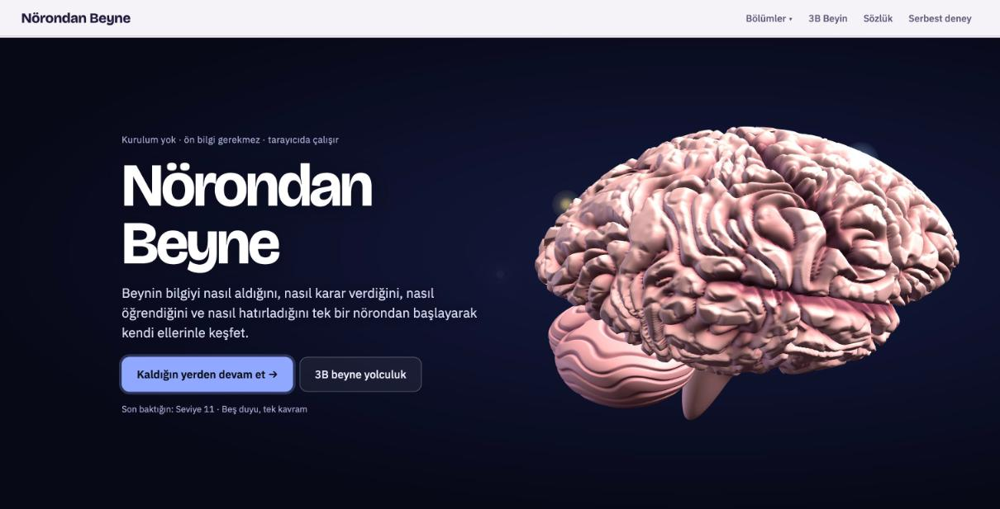
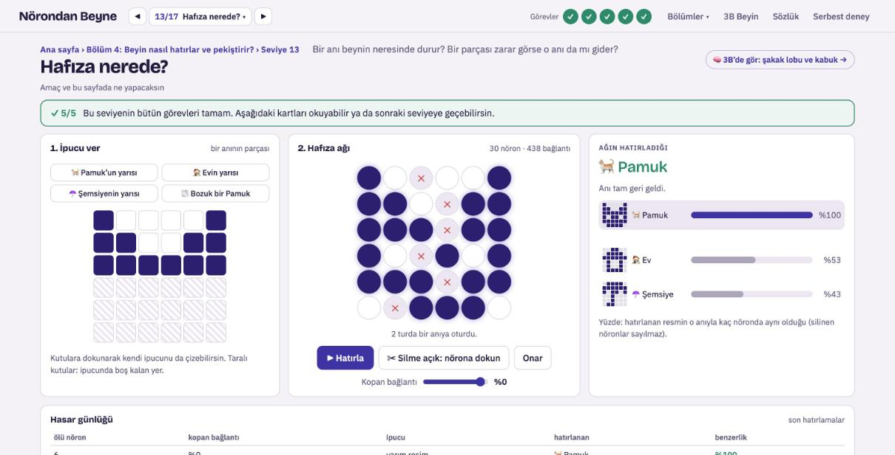
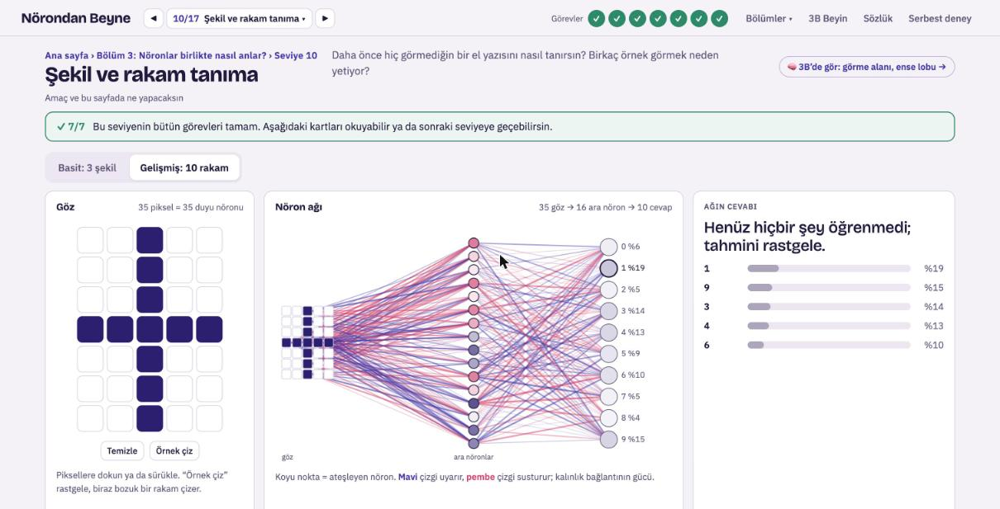
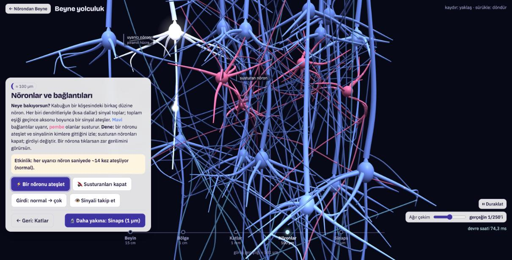
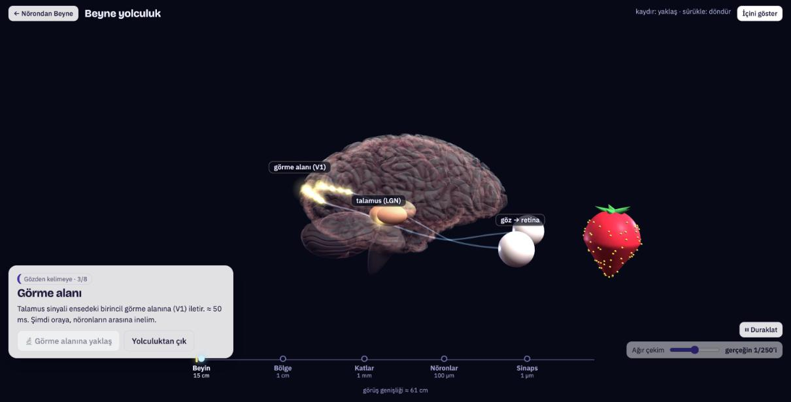

# Nörondan Beyne

Beynin bilgiyi nasıl aldığını, nasıl karar verdiğini, nasıl öğrendiğini ve nasıl hatırladığını **tek bir nörondan başlayarak kendi ellerinle** keşfettiğin, tarayıcıda çalışan bir öğrenme uygulaması.

**▶ Hemen dene:** <https://yucelgencler.github.io/brain/>



## Ne öğreneceksin?

Her seviye bir soruyla başlar. Küçük bir beyin devresiyle denersin, görevler seni adım adım bir keşfe götürür ve sonunda aynı şeyin gerçek beyinde nasıl olduğunu okursun. Kolaydan zora beş bölüm var:

| Bölüm     | Soru                                | Seviyeler                                                                                                              |
| --------- | ----------------------------------- | ---------------------------------------------------------------------------------------------------------------------- |
| Başlangıç | Beynin içine bir bak                | 3B tur: beyinden kabuğa, nöronlara ve sinapsa                                                                          |
| 1         | Bir nöron nasıl karar verir?        | 1 Tek bir ışık hücresi · 2 İki ışık, bir karar · 3 Susturan bağlantı                                                   |
| 2         | Nöron nasıl öğrenir?                | 4 Öğretmenle öğrenme · 5 Tahmin ederek öğrenme · 6 Tek nöronun duvarı                                                  |
| 3         | Nöronlar birlikte nasıl anlar?      | 7 Muz ve armut · 8 Gizli nöronlar · 9 Yatay mı dikey mi? · 10 Şekil tanıma · 11 Rakam tanıma · 12 Beş duyu, tek kavram |
| 4         | Beyin nasıl hatırlar ve pekiştirir? | 13 Birlikte yanan, birlikte bağlanır · 14 Hafıza nerede? · 15 Ezber mi, anlamak mı? · 16 Unutma ve uyku                |
| 5         | Kelimeler ve anlam                  | 17 Kelimelerin anlamı · 18 Okumak                                                                                      |
| Final     | Hepsi bir arada                     | 3B: bir limona, çileğe ya da dondurmaya baktığında gözden kelimeye giden yol                                           |

Hiçbir seviye kilitli değil; istediğin yerden başlayabilirsin. İlerlemen yalnızca kendi tarayıcında saklanır.

|                                                                                         |                                                                            |
| --------------------------------------------------------------------------------------- | -------------------------------------------------------------------------- |
|  |               |
|                       |  |

## Nasıl çalışır?

- **Dene:** Her seviye tek bir dokunuşla başlar: ışığı yak, bir kart göster, bir ipucu ver. Sonucu anında görürsün.
- **Keşfet:** Görevler kısa ve sırayla gelir; yeni kontroller ancak gerekince açılır. Parlayan düğme hep sıradaki adımı gösterir; görev bitince tek cümlelik bir açıklama, isteyene “Neden?”.
- **Derinleş:** Seviye bitince kısa bir “Beyninde de böyle” kartı çıkar. Hesaplar, bilimsel kaynaklar ve ek deneyler isteyene “Derinleş” bölümünde.
- **3B beyin:** Bütün beyinden tek bir sinapsa kadar yakınlaşabilir, nöronları ateşletip sinyalin nasıl aktığını izleyebilirsin. Her seviyeden “🧠 3B’de gör” ile o konunun beynin neresinde olduğuna gidersin.
- **Sözlük:** Nöron, sinaps, eşik gibi terimlerin sade açıklamaları.
- **Serbest deney:** Ayarları açık, rehbersiz bir laboratuvar (rakamlar, kelimeler, okuma).

Modeller gerçek beyni bire bir taklit etmez; fikirleri kendi ellerinle görebilmen için sadeleştirilmiştir. Her seviye neyi basitleştirdiğini açıkça yazar.

## Kendi bilgisayarında açmak

En kolayı: sayfanın yukarısındaki **Code → Download ZIP** ile indir, klasörü aç ve `index.html` dosyasına çift tıkla. İnternet bağlantısı gerekmez (yazı tipleri internetsizken sistem yazı tipine döner).

Yerel bir sunucuyla açmak istersen:

```
npm start          # http://localhost:8765
```

## Katkı

Yeni bir seviye fikrin, bir düzeltmen ya da bir önerin mi var? Çok sevinirim. Nasıl çalıştığını ve bir seviyenin nasıl eklendiğini [CONTRIBUTING.md](CONTRIBUTING.md) anlatıyor. Bir hata ya da öneri için “Issues” sekmesinden yazabilirsin.

## Geliştiriciler için kısaca

- Saf HTML, CSS ve JavaScript; derleme adımı yok. Tek dış kütüphane Three.js (r149, `vendor/` içinde).
- `npm test` bütün testleri çalıştırır (Node.js yeter, bağımlılık yok). Her seviyenin görevleri arayüzden bağımsız test edilir.
- `npm run format` kodu Prettier ile biçimlendirir. GitHub Actions her push ve pull request’te testleri ve biçimi denetler.

## Lisans

[MIT](LICENSE). Three.js de MIT lisanslıdır (`vendor/THREE-LICENSE`).

---

### In English

**Nörondan Beyne** (“From a Neuron to the Brain”) is a browser-based, hands-on course on how the brain perceives, decides, learns and remembers, starting from a single neuron. It has 18 guided levels in five chapters plus an interactive 3D brain you can zoom from the whole brain down to a single synapse. The interface is in Turkish. No build step, no dependencies: open `index.html`. Run the tests with `npm test`. MIT licensed.
